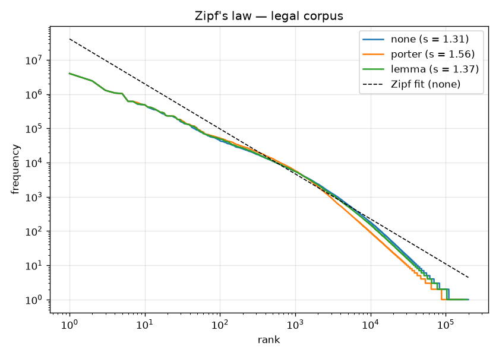
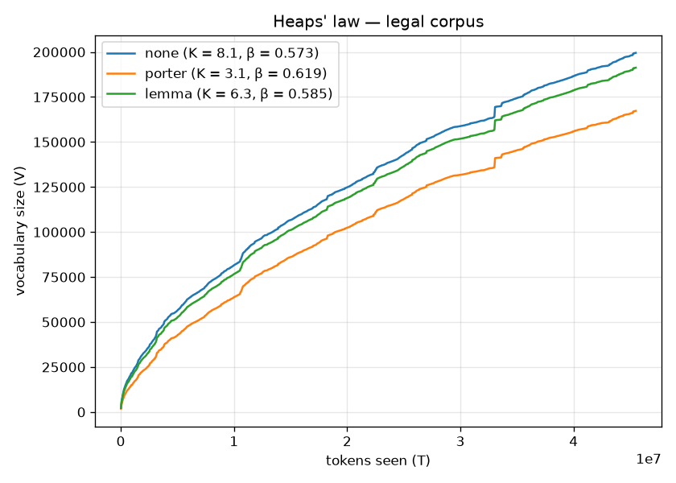

# Corpus statistics (Phase 2)

Corpus: `data/corpus_dedup.jsonl`, 4,730 documents, 45,494,347 tokens.
Generated by `corpus_stats.py`.

| Normalization | Vocabulary size | vs none | Zipf s | Heaps K | Heaps β |
|---|---|---|---|---|---|
| none | 199,500 | 100% | 1.31 | 8.1 | 0.573 |
| porter | 167,277 | 84% | 1.56 | 3.1 | 0.619 |
| lemma | 191,272 | 96% | 1.37 | 6.3 | 0.585 |

- Words that occur only once (hapax legomena): 89,817 (45% of the vocabulary).
- Stopwords make up 46% of all tokens.
- Zipf exponent fitted on ranks 10–10,000.

Top 20 words: the (3,999,434), of (2,435,619), to (1,286,706), in (1,078,964), and (1,039,288), is (613,563), that (612,213), be (513,250), or (490,930), by (488,764), for (412,004), as (383,477), on (355,136), it (345,752), not (323,717), was (293,296), court (270,793), section (262,149), any (237,588), which (231,821)

